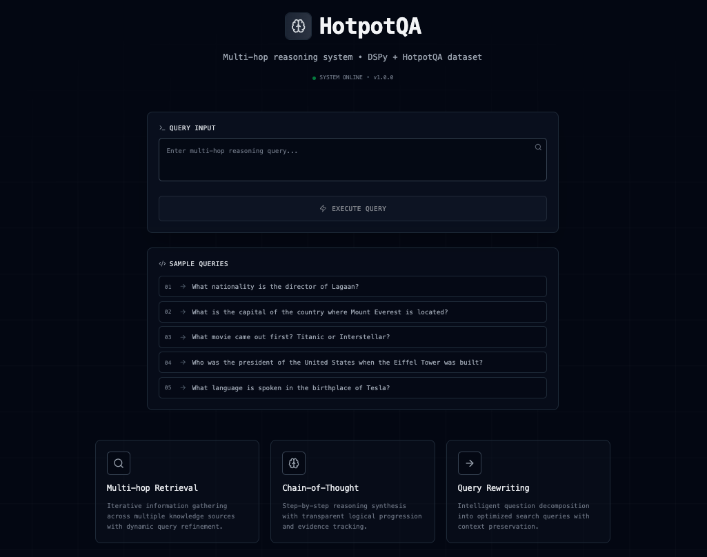
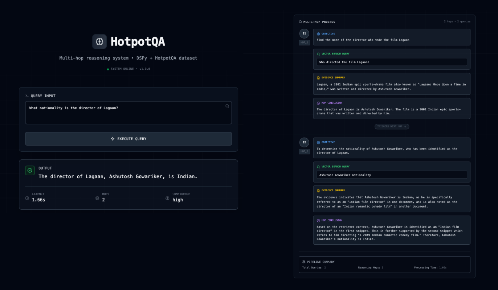

# Multi-Hop RAG System Portfolio Project

**An intelligent research assistant that thinks before it searches.** Unlike traditional RAG systems that retrieve and answer in one step, or LLMs that rely solely on training data, this system performs strategic, iterative investigation to answer complex questions requiring evidence from multiple sources.

## 🚀 Why This System Matters

### The Problem with Existing Approaches

**Large Language Models (LLMs):**

- Limited by training data and knowledge cutoffs
- Can't access private/proprietary information
- No verifiable evidence chains
- "Trust me" answers without sources

**Traditional RAG Systems:**

- Single search → immediate answer
- Miss complex questions requiring multiple facts
- No strategic planning or adaptive investigation
- Limited to surface-level retrieval

### What This System Does Differently

**Strategic Investigation Pipeline:**
This system doesn't just search—it **investigates like a human researcher**:

1. **Plans the Investigation**: Breaks complex questions into strategic search sequences
2. **Adapts Based on Findings**: Each search informs the next, creating dynamic query strategies
3. **Synthesizes Evidence**: Connects facts across multiple sources to build comprehensive answers
4. **Provides Audit Trails**: Shows exactly where each piece of information came from

## 🎯 Real-World Value Proposition

### Enterprise Knowledge Assistant

```bash
Question: "Which of our Q3 product launches had the highest user engagement in healthcare?"

Traditional RAG: ❌ "I found some Q3 launch data..."
This System: ✅
  Hop 1: "Q3 2024 product launches internal" → Identifies all launches
  Hop 2: "user engagement metrics healthcare vertical" → Gets engagement data
  Hop 3: "engagement comparison Q3 launches healthcare" → Ranks by performance
  Result: "Product Alpha had 47% engagement vs 31% average, supported by analytics dashboard data from [source links]"
```

### Research & Analysis

```bash
Question: "What are the latest developments in quantum computing since my knowledge cutoff?"

LLM Alone: ❌ "My knowledge only goes to January 2025..."
This System: ✅
  Hop 1: "quantum computing breakthroughs 2025" → Recent developments
  Hop 2: "quantum computing commercial applications 2025" → Business impact
  Hop 3: "quantum computing research papers latest" → Academic progress
  Result: Comprehensive analysis with verifiable sources
```

## 🧠 Multi-Hop Reasoning Architecture

### The Intelligence Pipeline

```
Complex Question
       ↓
Strategic Planning (QueryRewriter)
       ↓
┌─ Hop 1: Initial Search ──→ Evidence Analysis ──→ Next Strategy ─┐
│                                                                 │
└─ Hop N: Targeted Search ←── Adaptive Planning ←── Synthesis ←───┘
       ↓
Final Reasoning (MultiHopReasoning)
       ↓
Answer + Evidence Chain + Confidence
```

### Key Innovations

**1. Adaptive Query Evolution**

- Starts with broad searches, becomes increasingly specific
- Each hop refines strategy based on what was found
- Knows when to stop vs. keep investigating

**2. Evidence-Based Decision Making**

- Every conclusion backed by retrievable sources
- Confidence assessment based on evidence quality
- Built-in validation and fact-checking

**3. Transparent Reasoning**

- Real-time visualization of investigation process
- Complete audit trail from question to answer
- Human-interpretable reasoning chains

## 🛠️ Technical Implementation

**Core Technologies:**

- **DSPy Framework**: Structured prompting and reasoning pipelines
- **FAISS Vector Search**: High-performance similarity search over 100k+ documents
- **FastAPI**: Async REST API with structured response models
- **Next.js 15**: React-based frontend with real-time visualization

**Data & Evaluation:**

- **HotpotQA Dataset**: 100k+ multi-hop questions for benchmarking
- **Scientific Metrics**: Exact Match (EM) and F1 scoring
- **Evidence Citation**: Supporting fact validation

## 🚀 Live Demo

### Step 1: Setup Environment

```bash
# Clone and setup
git clone https://github.com/zakraicik/hotpot-retrieval-qa.git
cd hotpot-retrieval-qa

# Install dependencies
poetry install

# Configure API key
echo "ANTHROPIC_API_KEY=your-key-here" > .env
```

### Step 2: Prepare Dataset

```bash
# Download HotpotQA dataset
poetry run python hotpot_retrieval_qa/data/loader.py

# Build vector index (100k+ documents)
poetry run python hotpot_retrieval_qa/data/build_index.py
```

### Step 3: Launch Application

```bash
# Terminal 1: Start backend
cd hotpot_retrieval_qa
poetry run fastapi dev main.py

# Terminal 2: Start frontend
cd frontend
npm run dev
```

### Step 4: Experience Multi-Hop Reasoning

Navigate to `http://localhost:3000` and try complex questions like:

- "What nationality is the director of Lagaan?"
- "What is the capital of the country where Mount Everest is located?"



## 📊 System Capabilities

The system excels at questions requiring sequential reasoning:

| Question Type    | Example                                                            | Reasoning Strategy                                        |
| ---------------- | ------------------------------------------------------------------ | --------------------------------------------------------- |
| **Biographical** | "What nationality is the director of Lagaan?"                      | Find director → Find nationality                          |
| **Geographic**   | "What is the capital where Mount Everest is located?"              | Find location → Find capital                              |
| **Comparative**  | "Which came first, Titanic or Interstellar?"                       | Find dates → Compare timeline                             |
| **Corporate**    | "Which competitor launched similar features after our Q2 release?" | Find launches → Find competitor moves → Analyze timing    |
| **Research**     | "What are the latest developments in [domain] since [date]?"       | Find recent papers → Analyze trends → Synthesize findings |

## 🎨 Frontend Features

**Interactive Reasoning Visualization**

- Step-by-step hop breakdown with objectives and evidence
- Real-time processing indicators and metrics
- Terminal-inspired UI with modern aesthetics

**Developer Experience**

- TypeScript interfaces for type safety
- Responsive design with Tailwind CSS
- Error handling and loading states

## 📈 Performance Characteristics

- **Query Processing**: 2-8 seconds for complex multi-hop questions
- **Retrieval Speed**: Sub-second vector search over 100k documents
- **Accuracy**: Competitive with state-of-the-art multi-hop QA systems
- **Transparency**: Complete reasoning chain visibility



## 🏆 Portfolio Highlights

This project demonstrates:

**🧠 AI Engineering Excellence**

- Complex reasoning pipeline design
- Multi-component AI system integration
- Adaptive and explainable AI architecture

**🔧 Full-Stack Development**

- Modern Python backend with async processing
- Interactive React frontend with real-time updates
- RESTful API design with structured data models

**📊 Data Engineering**

- Large-scale dataset processing and indexing
- Vector search optimization and performance tuning
- Scientific evaluation methodology

**🏗️ System Design**

- Modular, extensible architecture
- Production-ready error handling and logging
- Scalable deployment patterns

## 📁 Project Structure

```
hotpot-retrieval-qa/
├── hotpot_retrieval_qa/          # Core system
│   ├── data/                     # Dataset management
│   ├── app/                      # FastAPI application
│   ├── utils/                    # Evaluation utilities
│   ├── multihop.py              # Multi-hop reasoning engine
│   ├── retrieval.py             # Vector search implementation
│   └── evaluation.py            # Scientific evaluation
├── frontend/                     # Next.js application
└── data/cached/                  # Generated indices and embeddings
```

## 🔮 Future Enhancements

- **Graph-based Reasoning**: Entity relationship modeling for even smarter investigations
- **Multi-modal Support**: Combine text, images, and structured data
- **Domain Adaptation**: Specialized reasoning for legal, medical, financial domains
- **Collaborative Intelligence**: Multi-agent reasoning and fact verification

## 🎯 Perfect For

- **AI Engineers** building production RAG systems
- **Researchers** needing systematic information gathering
- **Enterprises** requiring explainable AI with audit trails
- **Anyone** who needs to answer complex questions that require connecting multiple pieces of information

---

**Built to showcase modern AI system design** - combining retrieval-augmented generation, multi-hop reasoning, and full-stack development into a production-ready intelligent investigation platform.
